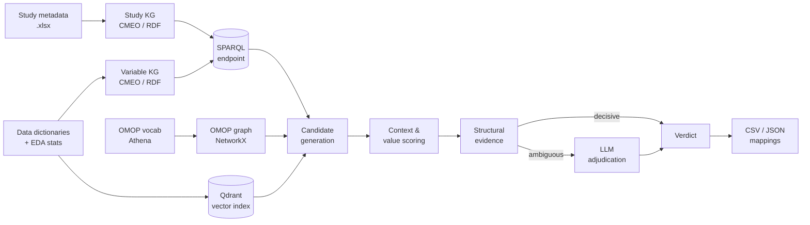

<div align="center">

# 🧬 CohortVarMatcher

**Hybrid semantic matching for metadata-driven cohort variable alignment**

[](https://www.python.org/)
[](https://athena.ohdsi.org)
[](https://qdrant.tech)
[](#-license)

[Overview](#-overview) •
[How it works](#%EF%B8%8F-how-it-works) •
[Installation](#-installation) •
[Quick start](#-quick-start) •
[Output](#-output) •
[Project structure](#-project-structure)

</div>

---

## 📖 Overview

CohortVarMatcher finds equivalent and related variables across clinical cohort studies using only their metadata: data dictionaries, OMOP codes and study descriptions. No patient-level data is needed.

For each source → target study pair it:

1. proposes candidate variable pairs from the OMOP concept graph and from embeddings,
2. checks whether their values can be pooled (type, units, categories, ranges, visits),
3. assigns a **harmonization status** and the **transformation** required.

An LLM is consulted only for pairs the structural checks cannot decide.

> Formerly **CohortVarLinker**.

### ✨ Features

- 🔗 **Ontology-grounded candidates** from OMOP standard concepts (SNOMED CT, LOINC, RxNorm, ATC, UCUM) and their hierarchy
- 🧠 **Embedding retrieval** with biomedical models (BioLORD, SapBERT, CODER, MedEmbed, OpenAI, …)
- 📏 **Structural checks** on units, category sets, value ranges and statistical type
- 🔄 **Transformation hints**: unit conversion, categorical recoding, binary extraction, timepoint alignment
- 🧮 **Derived variables**: BMI, eGFR (CKD-EPI, MDRD, Cockcroft-Gault), MAP, pulse pressure, BSA, LDL (Friedewald), QTc and more
- 🗓️ **Visit-aware matching** across study timelines
- 🤖 **Selective LLM adjudication** with study-design context (LiteLLM, OpenRouter, Fireworks, OpenAI, Gemini, Ollama)
- 🕸️ **RDF knowledge graph** of studies and variables based on the CMEO ontology

### 📌 Use cases

- Harmonizing variable definitions across cardiovascular cohorts
- Preparing data for federated analysis or pooled modelling
- Semantic search and comparison in cohort exploration tools

---

## ⚙️ How it works



| Stage | Module |
|---|---|
| Study & variable knowledge graphs | `src/study_kg.py`, `src/variables_kg.py` |
| Embedding index | `src/vector_db.py`, `src/embed_model.py` |
| Candidate generation | `src/neuro_matcher.py`, `src/omop_graph_nx.py`, `src/query_builder.py` |
| Context & category scoring | `src/graph_similarity.py` |
| Structural evidence | `src/constraints.py` |
| LLM adjudication | `src/llm_call.py`, `src/study_context.py` |
| Final verdict | `src/policy.py`, `src/verdict.py` |

### Mapping modes

| Mode | Candidates from | LLM |
|---|---|:---:|
| `OO` | Ontology only | ❌ |
| `OEC` | Ontology + concept embeddings | optional |
| **`OEH`** (default) | Ontology + hybrid label/concept embeddings | optional |
| `NE` | Embeddings only | optional |

---

## 📦 Installation

### Prerequisites

| Component | Default | Notes |
|---|---|---|
| Python | 3.10+ | |
| SPARQL 1.1 endpoint | `http://localhost:7879` | Query + update, e.g. [Oxigraph](https://github.com/oxigraph/oxigraph) |
| Qdrant | `localhost:6333` | |
| OMOP vocabularies | — | `CONCEPT`, `CONCEPT_RELATIONSHIP`, `CONCEPT_SYNONYM` from [Athena](https://athena.ohdsi.org) |
| LLM endpoint | — | Only if LLM adjudication is used |

### Install

```bash
git clone https://github.com/<your-org>/CohortVarMatcher.git
cd CohortVarMatcher
python -m venv .venv && source .venv/bin/activate
pip install pandas numpy rdflib SPARQLWrapper qdrant-client networkx \
            torch transformers scikit-learn thefuzz pydantic python-dotenv requests
```

### Start services

```bash
docker run -d -p 6333:6333 qdrant/qdrant
docker run -d -p 7879:7878 oxigraph/oxigraph serve --location /data --bind 0.0.0.0:7878
```

### Configure

Create a `.env` file in the repository root:

```ini
SPARQL_ENDPOINT=http://localhost:7879

# LLM providers (set the ones you use)
LITELLM_BASE_URL=
LITELLM_API_KEY=
OPENAI_API_KEY=
GEMINI_API_KEY=
OPENROUTER_API_KEY=
FIREWORKS_API_KEY=
```

### Prepare the OMOP vocabulary

Set `athena_vocab_dir` and `output_dir` in `pre_process_vocab.py`, then:

```bash
python pre_process_vocab.py
```

This adds UCUM hierarchy, synonyms and SNOMED–ATC equivalences (via RxNorm) and writes `concept_relationship_enriched.csv`.

---

## 🚀 Quick start

### 1. Arrange input data

`main.py` expects a `data/` folder **next to** the repository:

```
../data/
├── studies_metadata-2_all.xlsx       # one row per study
├── concept_relationship_enriched.csv # from pre_process_vocab.py
└── cohorts/
    ├── time-chf/
    │   ├── dictionary.csv            # variable data dictionary
    │   └── eda_time-chf.json         # optional summary statistics
    └── gissi-hf/
        └── ...
```

<details>
<summary><b>Data dictionary columns</b></summary>

| Column | Required |
|---|:---:|
| `variablename` | ✅ |
| `variablelabel` | ✅ |
| `variable omop id` | ✅ |
| `variable concept name` | |
| `additional context omop id` | |
| `units` | |
| `categorical` | |
| `vartype` | |
| `visits` | |

</details>

### 2. Configure the run

Edit the `__main__` block in `main.py`:

```python
source_study   = "gissi-hf"
target_studies = ["time-chf", "biostat-chf", "viennahf-register", "aachen-hf"]
model_name     = "biolord"                 # see MODEL_MAP in src/embed_model.py
mapping_mode   = MappingType.OEH.value
llm_model      = "litellm/gpt-oss:120b"    # or None to disable the LLM
```

On the **first run**, set `recreate=True` for both graph builders and `recreate_db=True` for `generate_studies_embeddings`. Set them back to `False` afterwards.

### 3. Run

```bash
python main.py
```

> 💡 Changing the embedding model requires rebuilding the Qdrant collection.

---

## 📊 Output

```
../data/output/cross_mapping/<model>/<mode>/
├── <source>_<target>_<model>+<llm>_<mode>_full.csv   # one per study pair
└── <source>_<targets>_<model>+<llm>_<mode>.json      # all targets, keyed by source variable
```

### Harmonization status

| Status | Meaning |
|---|---|
| 🟢 **Identical Match** | Same concept, type, unit and categories; pool as is |
| 🔵 **Compatible Match** | Same concept; needs a deterministic transformation |
| 🟡 **Partial Match** | Related but not equivalent (broader/narrower, different context, lossy recoding) |
| ⚪ **Not Applicable** | Not combinable; excluded from output |

### Transformation types

`None` · unit conversion · unit alignment · categorical value normalization · categorical aggregation/expansion · binary extraction · timepoint alignment · derivation · manual review

<details>
<summary><b>CSV columns</b></summary>

| Group | Columns |
|---|---|
| Pair | `source`, `target`, `source_label`, `target_label` |
| Concepts | `somop_id`, `tomop_id`, `scode`, `tcode`, `slabel`, `tlabel`, `category` |
| Timing | `source_visit`, `target_visit` |
| Match | `mapping_relation`, `sim_score` |
| Values | `*_type`, `*_unit`, `*_categories_labels`, `*_categories_omop_ids`, `*_original_categories`, `*_min_val`, `*_max_val`, `*_data_type` |
| Context | `*_composite_code_labels`, `*_composite_code_omop_ids`, `*_composite_code_codes` |
| Result | `derived_variable_name`, `transformation_type`, `transformation_rule`, `Mapping Description`, `harmonization_status`, `LLMEvidence` |

</details>

> ⚠️ `mapping_relation` (`symbolic:exactmatch`, `symbolic:broadmatch`, …, `neural match`) is the **concept-level** link. Use `harmonization_status` to judge whether the variables themselves are equivalent.

Studies linked by `obi:has_member` (e.g. a cohort and its outcomes table) are merged into the parent study's CSV.

---

## 🗂️ Project structure

```
CohortVarMatcher/
├── main.py                 # Entry point: build graphs, index, run study pairs
├── pre_process_vocab.py    # Enrich Athena OMOP relationships
├── src/
│   ├── run.py              # StudyMapper: per study-pair pipeline
│   ├── neuro_matcher.py    # Symbolic + neural candidate generation
│   ├── omop_graph_nx.py    # OMOP concept graph & hierarchy
│   ├── constraints.py      # Structural checks by statistical type
│   ├── policy.py           # Final decision rules per mapping mode
│   ├── verdict.py          # Evidence & verdict dataclasses
│   ├── llm_call.py         # LLM prompts & parsing
│   ├── study_kg.py         # Study metadata → RDF
│   ├── variables_kg.py     # Data dictionary → RDF
│   ├── vector_db.py        # Qdrant index
│   ├── embed_model.py      # Embedding model registry
│   └── config.py           # Thresholds, endpoints, derived-variable rules
└── data/
    ├── graphs/             # Serialized RDF (.trig)
    └── output/             # Published results & sensitivity analyses
```

---

## 📝 Citation

Manuscript in preparation. Citation details will be added on publication.

## 📄 License

No license has been selected yet.
